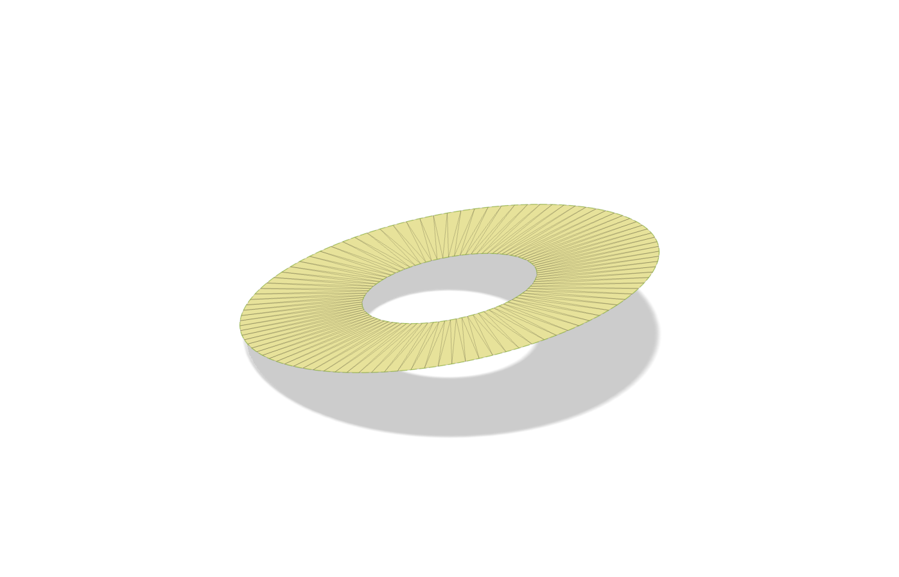
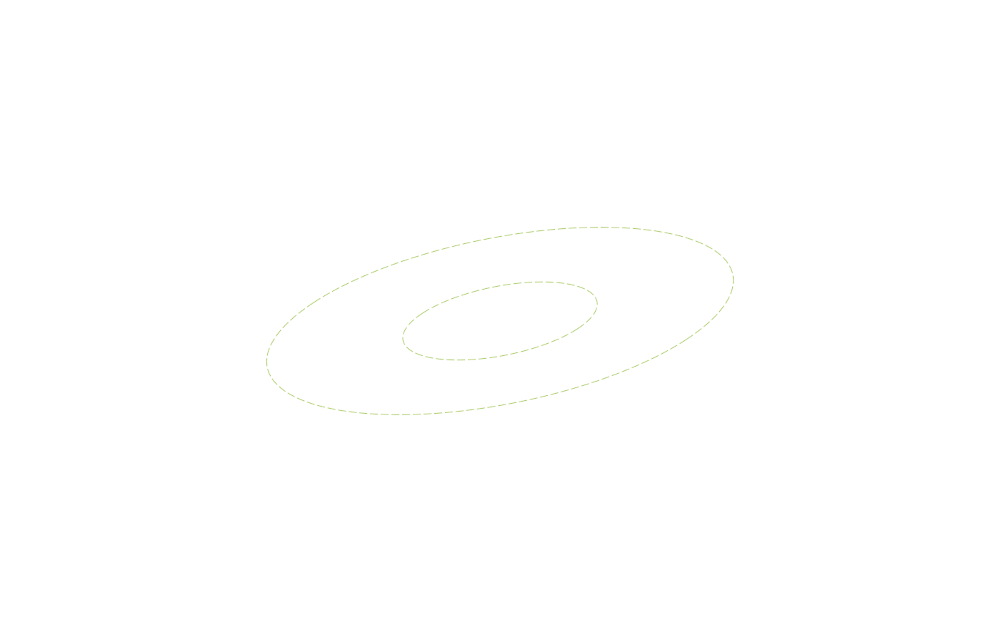
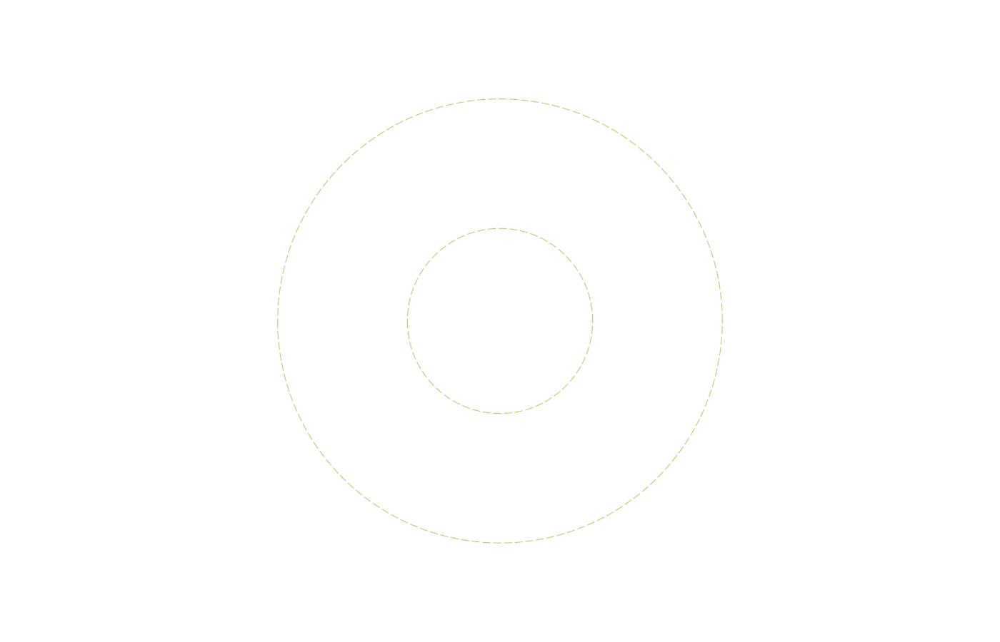

# Synthetic example

These images are actual Fusion viewport exports generated from a tilted annular mesh created by `tools/create_demo.py` in the source repository. No downloaded or private model is included.

## Mesh and 3D boundary

The source mesh has an outer perimeter and an inner hole. Mesh Boundary to Curves fits native 3D curves to both.

## Boundary curves with mesh hidden

Generated curves are fixed construction geometry. The tilted shape stays in 3D; the inner and outer perimeters remain separate.

## Perpendicular projection into an XY sketch

Project Mesh Face Group flattens the selected perimeter into the target sketch plane. Projection is fixed construction geometry and is a snapshot, not a live mesh link.

## Reproduce

Inside a Fusion Python script context, load `tools/create_demo.py` and call its `run(context)` entry point. It creates a temporary synthetic design, tests the standalone package, exports the images above, closes the temporary design without saving, and restores the previously active document.
